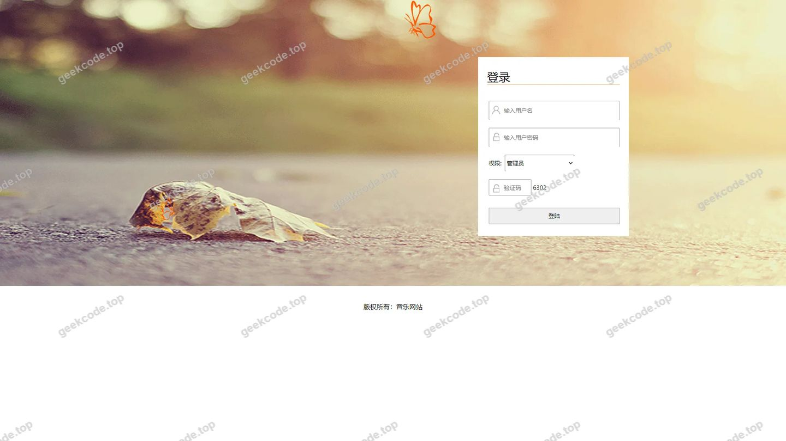
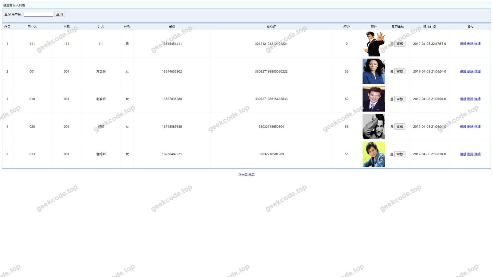
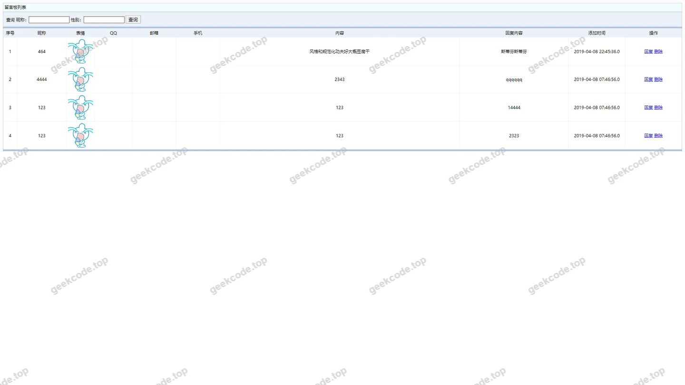
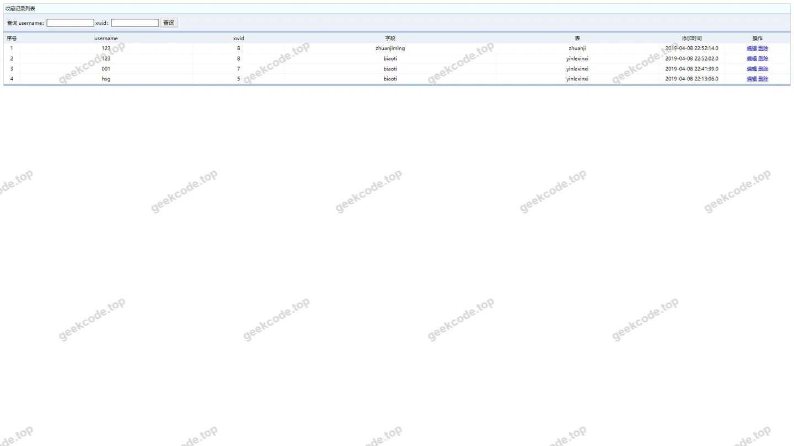
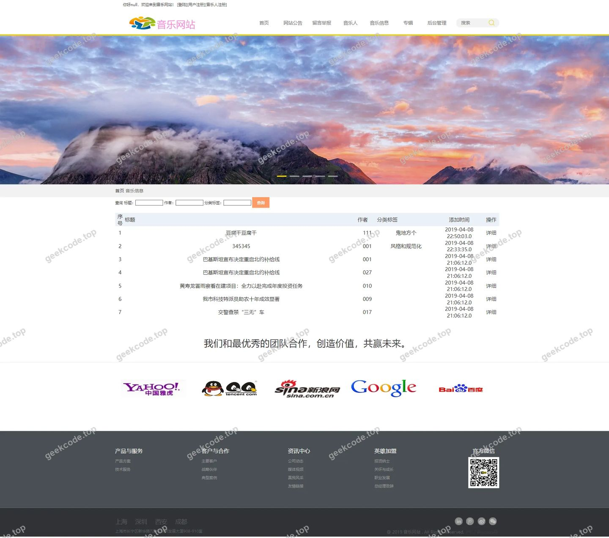
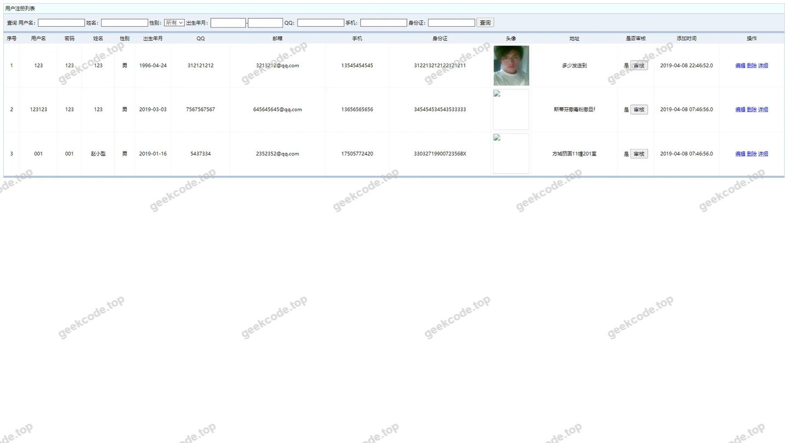
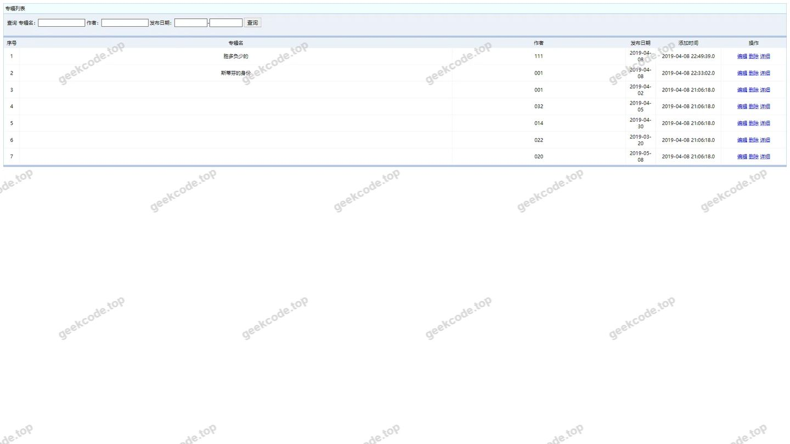
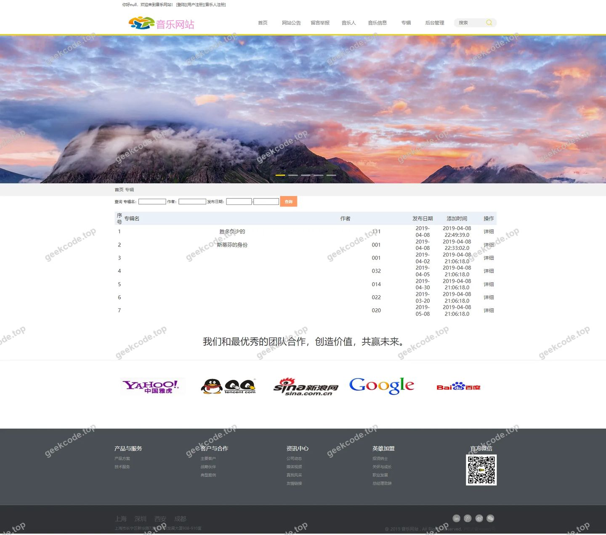
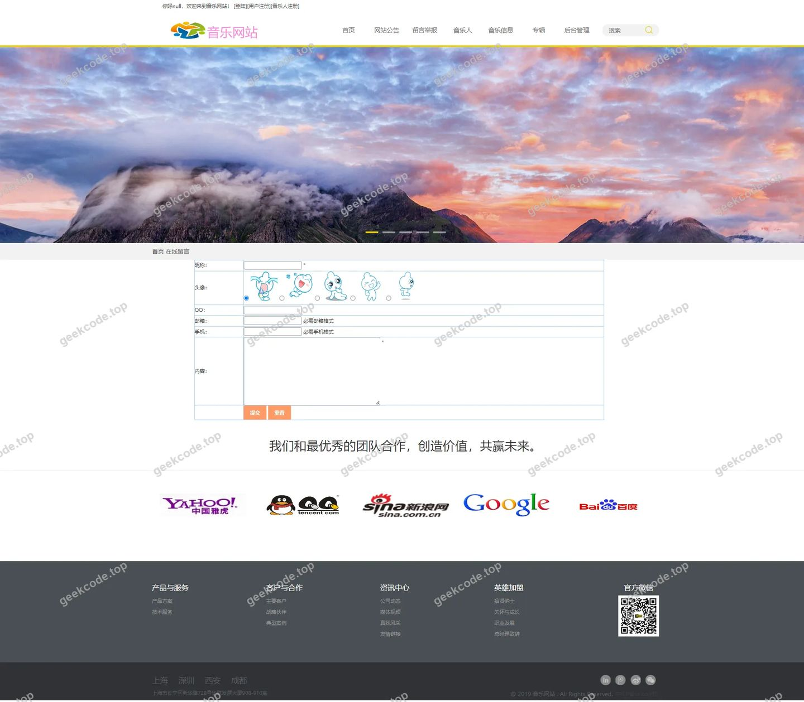

# ssm音乐网站

> 🎓 **计算机毕业设计 · ssm音乐网站**
>
> 本仓库只放**项目介绍 + 运行截图**（截图是站点带水印的原图，存在仓库 `images/` 里）。
>
> 👉 **完整可运行源码 / 数据库脚本 / 部署文档：[点我获取](https://geekcode.top/archives/ssm%E9%9F%B3%E4%B9%90%E7%BD%91%E7%AB%99?utm_source=github)**
>
> 💬 咨询微信：**ir9372**　|　🌐 更多项目：[极客代码 geekcode.top](https://geekcode.top/?utm_source=github)
>
> 📌 项目详情页：<https://geekcode.top/archives/ssm%E9%9F%B3%E4%B9%90%E7%BD%91%E7%AB%99?utm_source=github>

<table><td width="230" align="center"> <b>扫码加微信 ir9372</b></td><td valign="middle">📦 源码 = 项目介绍 + 全部运行截图 + 数据库 + 部署文档 👉 点上方任意截图，直接跳到 <b>极客代码 geekcode.top</b> 详情页</td></table>

---

<h1>ssm音乐网站</h1>
<h2>项目概述</h2>

本项目名为“SSM音乐网站”，是一个基于 Java Web 技术栈开发的在线音乐服务平台。项目采用经典的 SSM（Spring + Spring MVC + MyBatis）框架结合 JSP 前端页面进行构建，旨在为普通用户和音乐人提供一站式的音乐资源浏览、管理及互动服务。

核心功能涵盖音乐信息展示、专辑管理、独立音乐人入驻、用户注册登录、评论留言、收藏记录以及系统公告等模块。适用人群包括喜爱音乐的用户、希望推广作品的独立音乐人以及负责内容审核与运营的管理员。虽然项目类型标记为 JSP 且未明确区分传统意义上的前后端分离架构，但其通过后台路由逻辑实现了数据交互与管理功能，整体架构清晰，适合用于计算机专业毕业设计，展示对 Java Web 全栈开发流程的理解与实践。

<h2>技术架构</h2>

本项目采用传统的单体 Java Web 应用架构，主要技术选型如下：

<ol>
<li><strong>后端框架</strong>：</li>
</ol>
<ul>
<li><strong>Spring</strong>：作为核心容器，负责 Bean 的管理、依赖注入及事务控制。</li>
<li><strong>Spring MVC</strong>：处理 HTTP 请求分发，控制器层负责接收前端参数并调用业务逻辑。</li>
<li><strong>MyBatis</strong>：持久层框架，通过 XML 或注解方式配置 SQL 映射，实现对象与关系数据库之间的交互。</li>
</ul>
<ol start="2">
<li><strong>前端技术</strong>：</li>
</ol>
<ul>
<li><strong>JSP (JavaServer Pages)</strong>：服务端渲染技术，直接嵌入 HTML 中动态生成页面内容。根据截图列表，页面包含 <code>yinlexinxi</code>（音乐信息）、<code>zhuanji</code>（专辑）、<code>liuyanban</code>（留言板）等列表页，表明前端主要承担数据展示与表单提交功能。</li>
</ul>
<ol start="3">
<li><strong>数据库设计要点</strong>：</li>
</ol>
<ul>
<li>基于 MySQL 数据库。从截图中的实体名称推断，主要数据表包括：</li>
<li><code>users</code> / <code>yonghuzhuce</code>：存储普通用户及管理员账户信息。</li>
<li><code>duliyinleren</code> / <code>dlylr</code>：存储独立音乐人信息及作品关联。</li>
<li><code>yinlexinxi</code> / <code>ylxx</code>：存储具体的音乐曲目详情。</li>
<li><code>zhuanji</code> / <code>zj</code>：存储专辑元数据。</li>
<li><code>pinglun</code>：存储用户对音乐或专辑的评论内容。</li>
<li><code>shoucangjilu</code>：存储用户的收藏行为记录。</li>
<li><code>liuyanban</code> / <code>lyb</code>：存储公共留言板数据。</li>
<li><code>xinwentongzhi</code>：存储系统发布的新闻或公告。</li>
<li><code>youqinglianjie</code>：存储友情链接数据。</li>
<li><code>zhanneixin</code>：存储站内信消息。</li>
</ul>
<ol start="4">
<li><strong>核心技术选型理由</strong>：
   SSM 框架组合成熟稳定，文档丰富，适合初学者掌握 Java Web 的核心开发模式。JSP 技术无需复杂的前端工程化配置，便于快速搭建基于服务器的动态网页，符合毕业设计对于完整业务流程演示的需求。</li>
</ol>
<h2>功能模块</h2>

根据提供的截图功能列表，系统将功能划分为以下主要模块：

<h3>1. 基础认证与入口模块</h3>
<ul>
<li><strong>登录页</strong>：提供用户和管理员的统一身份验证入口。</li>
<li><strong>用户注册</strong>：允许新用户创建账号，填写基本信息。</li>
<li><strong>音乐人注册</strong>：专门面向独立音乐人的入驻申请通道，可能涉及更详细的资质审核字段。</li>
</ul>
<h3>2. 音乐内容展示与管理模块</h3>
<ul>
<li><strong>音乐信息列表 (<code>yinlexinxi</code>/<code>ylxx</code>)</strong>：展示平台上的所有歌曲条目，支持查看详细信息。</li>
<li><strong>专辑列表 (<code>zhuanji</code>/<code>zj</code>)</strong>：以专辑为单位聚合音乐，展示封面、简介及收录曲目。</li>
<li><strong>独立音乐人列表 (<code>duliyinleren</code>/<code>dlylr</code>)</strong>：展示入驻的音乐人主页及其相关作品索引。</li>
</ul>
<h3>3. 用户互动模块</h3>
<ul>
<li><strong>评论列表 (<code>pinglun</code>)</strong>：显示针对特定音乐或专辑的用户评价。</li>
<li><strong>收藏记录 (<code>shoucangjilu</code>)</strong>：用户个人中心可查看已收藏的歌曲或专辑。</li>
<li><strong>留言板 (<code>liuyanban</code>/<code>lyb</code>)</strong>：提供公共交流区域，用户可发布留言，管理员可进行回复或删除操作。</li>
<li><strong>站内信 (<code>zhanneixin</code>)</strong>：系统内部的消息通知机制，用于发送个性化提醒或私信。</li>
</ul>
<h3>4. 系统管理与资讯模块</h3>
<ul>
<li><strong>网站公告 (<code>xinwentongzhi</code>)</strong>：管理员发布的全站通知，如活动预告、政策更新等。</li>
<li><strong>友情链接 (<code>youqinglianjie</code>)</strong>：展示外部合作站点链接，增强网站SEO及社区属性。</li>
<li><strong>用户列表 (<code>allusers</code>)</strong>：管理员视角下的所有注册用户概览，用于权限管理或封禁操作。</li>
</ul>
<h2>用户角色与权限</h2>

尽管项目元数据中“是否有前台/后台”标记为否，但根据截图中的 <code>[admin]</code> 标识及常规 Web 系统设计，可识别出以下角色体系：

<table>
<thead>
<tr>
<th align="left">角色</th>
<th align="left">描述</th>
<th align="left">可访问/操作的功能模块</th>
</tr>
</thead>
<tbody><tr>
<td align="left"><strong>游客</strong></td>
<td align="left">未登录用户</td>
<td align="left">浏览首页、查看音乐列表、查看专辑、查看独立音乐人、查看留言板、查看友情链接、访问登录/注册页。</td>
</tr>
<tr>
<td align="left"><strong>普通用户</strong></td>
<td align="left">已注册的听众</td>
<td align="left">游客的所有权限 + 发表评论、收藏音乐/专辑、查看个人收藏记录、收发站内信、在留言板发言。</td>
</tr>
<tr>
<td align="left"><strong>独立音乐人</strong></td>
<td align="left">已认证的创作者</td>
<td align="left">普通用户的所有权限 + 维护个人资料、上传/管理自己的音乐作品（推测）、查看自己作品的评论与收藏数据。</td>
</tr>
<tr>
<td align="left"><strong>管理员</strong></td>
<td align="left">系统运维人员</td>
<td align="left">拥有最高权限。具体包括：1. <strong>用户管理</strong>：查看所有用户列表 (<code>allusers</code>)，审核注册信息。2. <strong>内容管理</strong>：增删改查音乐信息 (<code>yinlexinxi</code>)、专辑 (<code>zhuanji</code>)、独立音乐人资料 (<code>duliyinleren</code>)。3. <strong>互动管理</strong>：审核或删除评论 (<code>pinglun</code>)、回复或删除留言 (<code>liuyanban</code>)。4. <strong>系统设置</strong>：发布网站公告 (<code>xinwentongzhi</code>)、维护友情链接 (<code>youqinglianjie</code>)、发送站内信 (<code>zhanneixin</code>)。</td>
</tr>
</tbody></table>

<em>注：截图中出现了“司宪策”这一具体人名对应的 admin 页面，推测该为测试数据或特定管理员账户的详情页。</em>

<h2>项目特色与创新点</h2>
<ol>
<li><strong>垂直领域细分</strong>：不同于通用的视频或音频播放器，本项目专注于“独立音乐人”生态，设置了专门的 <code>duliyinleren</code> 模块，体现了对小众音乐创作群体的关注与支持。</li>
<li><strong>完整的社交闭环</strong>：集成了评论、收藏、留言板、站内信等多种互动形式，构建了较为丰富的用户社区氛围，增强了用户粘性。</li>
<li><strong>经典架构稳定性</strong>：采用成熟的 SSM+JSP 技术栈，代码结构分层清晰（Controller-Service-Dao），易于维护和扩展，非常适合教学演示及毕业设计的规范性要求。</li>
<li><strong>多角色差异化体验</strong>：通过区分普通用户与音乐人注册流程，以及后台对内容的精细化管控，实现了不同用户在平台上的价值最大化。</li>
</ol>
<h2>部署环境</h2>

运行本项目所需的软件环境如下：

<ol>
<li><strong>操作系统</strong>：Windows 7/10/11, Linux (CentOS/Ubuntu), macOS。</li>
<li><strong>JDK 版本</strong>：建议 JDK 1.8 或以上版本（需兼容 Spring 5.x 及 Tomcat 9）。</li>
<li><strong>Web 服务器</strong>：Apache Tomcat 8.5 或 9.0。</li>
<li><strong>数据库</strong>：MySQL 5.7 或 MySQL 8.0。</li>
<li><strong>开发工具</strong>：IntelliJ IDEA 或 Eclipse Enterprise Edition。</li>
<li><strong>构建工具</strong>：Maven 3.6+（用于依赖管理，假设项目使用 Maven 构建，若为传统 WAR 包则无需强制）。</li>
<li><strong>浏览器</strong>：Chrome, Firefox, Edge 等现代主流浏览器（IE 兼容性视具体 CSS/JS 写法而定，通常不推荐）。</li>
</ol>

<strong>启动步骤简述</strong>：

<ol>
<li>安装并配置 MySQL，导入项目提供的 <code>.sql</code> 数据库脚本。</li>
<li>修改项目中 <code>jdbc.properties</code> 或 <code>applicationContext.xml</code> 中的数据库连接 URL、用户名和密码。</li>
<li>在 IDE 中配置 Tomcat 服务器，将项目部署至 Tomcat。</li>
<li>启动 Tomcat，访问 <code>http://localhost:8080/[项目名称]</code> 进入登录页。</li>
</ol>
<h2>五、技术特性</h2>
<ul>
<li>服务端模板渲染（JSP）</li>
</ul>
<h2>六、功能模块截图</h2>
<h3>前台用户端</h3>
<h4>登录页</h4>

<h4>页面-duliyinleren列表</h4>

<h4>页面-dlylr列表</h4>

<h4>页面-liuyanban列表</h4>

<h4>页面-lyb列表</h4>

<h4>页面-pinglun列表</h4>

<h4>页面-shoucangjilu列表</h4>

<h4>页面-xinwentongzhi列表</h4>

<h4>页面-yinlexinxi列表</h4>

<h4>页面-ylxx列表</h4>

<h4>页面-yonghuzhuce列表</h4>

<h4>页面-youqinglianjie列表</h4>

<h4>页面-zhanneixin列表</h4>

<h4>页面-zhuanji列表</h4>

<h4>页面-zj列表</h4>

<h4>页面-系统首页</h4>

<h4>页面-[登陆]</h4>

<h4>页面-[用户注册]</h4>

<h4>页面-[音乐人注册]</h4>

<h4>页面-网站公告</h4>

<h4>页面-我要留言</h4>

<h4>页面-司宪策</h4>

<h3>后台管理端</h3>
<h4>页面-allusers列表</h4>

---

## 获取完整源码

| 项目 | 说明 |
| --- | --- |
| 项目名 | ssm音乐网站 |
| 运行截图 | 本文 20 张（站点带水印原图，仓库 `images/` 目录） |
| 完整源码 | [https://geekcode.top/archives/ssm%E9%9F%B3%E4%B9%90%E7%BD%91%E7%AB%99?utm_source=github](https://geekcode.top/archives/ssm%E9%9F%B3%E4%B9%90%E7%BD%91%E7%AB%99?utm_source=github) |
| 咨询微信 | **ir9372**（备注：jingpin-yuanma） |
| 更多项目 | [极客代码 geekcode.top](https://geekcode.top/?utm_source=github) |

> 需要源码、部署、改配置、跑不起来等问题，加微信 ir9372 沟通，说明项目名即可。
